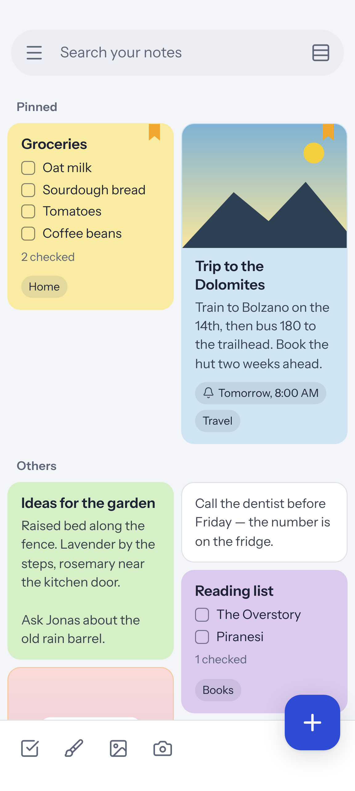
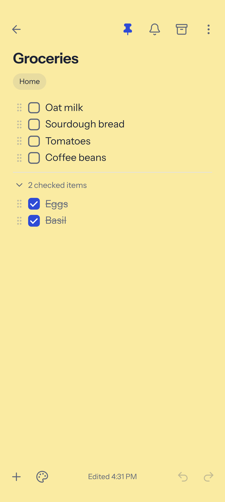
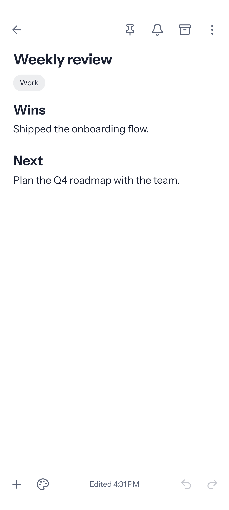
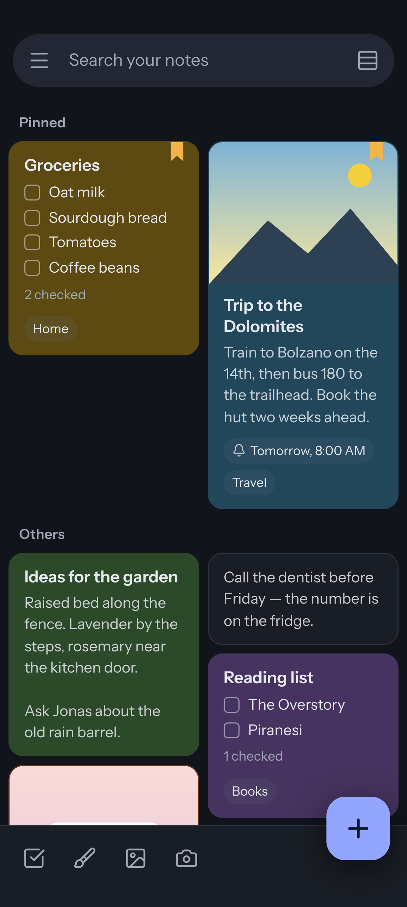

# Notebound

Private notes for Android that live in a folder you own.

Notebound combines the quick, colourful overview of Google Keep with a calm, capable editor in the spirit of Notesnook, without accounts, sync servers or subscriptions. Every note is a normal `.html` file in a folder you choose (for example `Documents/Notebound`), so backing up your notes is as simple as backing up that folder.

<p>




</p>

## Privacy

- **No internet permission.** The app cannot send anything anywhere; it does not even ask Android for network access.
- **No account, no tracking, no ads, no Google services.** Works on GrapheneOS, LineageOS and phones without Google Play.
- **Your files.** Notes, attachments, version history and settings are plain files in your folder. Open them in any browser or text editor.
- **Locked notes** are encrypted with AES-256-GCM using a key derived from your vault password (PBKDF2-SHA256, 310,000 rounds). If you forget the password, nobody can recover those notes.
- **App lock** with fingerprint, face or your phone PIN, plus an option to block screenshots and hide the app in the recent-apps screen.

## Features

**Overview (Keep style)**
- Staggered grid or list of colourful cards, pinned notes on top, background patterns
- Drag to reorder, swipe to archive (with undo), long-press to select many notes
- Labels, notebooks with sub-notebooks, favorites, archive, trash (auto-empties after 7 days, adjustable)
- Search with filters: reminders, lists, images, drawings, links, files, locked, labels, notebooks, colors
- Reminders (once, daily, weekly, monthly, yearly) with snooze; they survive reboots
- Home screen widgets (quick note bar, notes list) and app shortcuts

**Editor (Notesnook style)**
- Headings, bulleted, numbered and check lists, quotes, callouts, tables, code blocks with syntax highlighting, LaTeX math, collapsible sections, dividers, small text
- Text colour, highlight, alignment, sub/superscript, spoilers, links
- `/` command menu, `#label` to file a note under a label while typing, links between notes with `[[` and backlinks, find and replace, outline, word count
- Images from the gallery or camera, file attachments, finger and stylus drawings (saved as SVG, editable later)
- Keep-style checklists: checked items move to the bottom under a foldable "checked items" divider, drag handles, "uncheck all", "delete checked items", show/hide checkboxes
- Version history with restore, read-only mode, make a copy, send, export
- Right-to-left text works automatically per paragraph

**Typing shortcuts (Discord style)**

| Type | Result |
| --- | --- |
| `**bold**` | **bold** |
| `*italic*` or `_italic_` | *italic* |
| `__underline__` | underline |
| `~~strike~~` | ~~strike~~ |
| `\|\|spoiler\|\|` | hidden until tapped |
| `` `code` `` | inline code |
| ` ``` ` then Enter (or ` ```python `) | code block |
| `# `, `## `, `### ` | headings |
| `> ` | quote |
| `- ` or `1. ` | lists |
| `[] ` | checkbox |
| `-# ` | small grey text |
| `[text](https://…)` | link |
| `:smile:` or `:` and a name | emoji 😄 |
| `==text==` | highlight |
| `$$x^2$$` | inline math |

**Import and export**
- Import Google Keep (Takeout `.zip`), Notesnook exports, Notebound backups, and `.md` / `.txt` / `.html` files
- Export notes as HTML, Markdown or plain text (a `.zip` with attachments for several notes), or as PDF via Android printing
- Full backup `.zip` of the whole folder

## Your folder

```
Notebound/
  notes/            one .html file per note, e.g. "Shopping list_k3f9x2ab.html"
  attachments/      images, drawings (.svg), files
  history/          earlier versions of notes, one folder per note
  notebound.json    labels, notebooks and settings
```

Each note file is a complete HTML page. Its colour, labels, notebooks, pin, reminder and other details are stored inside the file in a `<script type="application/json" id="notebound-meta">` block, so restoring a single file restores the whole note. Notes can be edited by other apps; Notebound notices the change when you return to it, and keeps the replaced version in history if both sides edited at once. Plain `.html` files you drop into `notes/` show up as notes too.

Folders made by the first test builds, which were called Pocketbook, open as they are: their notes, locked notes and drawings are read without changes, and the settings in `pocketbook.json` are copied into `notebound.json` once (the old file is left alone).

## Install

Download the APK from the [Releases](../../releases) page and open it on your phone. It runs on Android 5.0 and newer, with or without Google services. The screens are drawn by the phone's Android System WebView, which needs to be version 80 or newer (any phone that has received app updates since 2020 has that; on GrapheneOS it is Vanadium, always current). If the WebView is too old, Notebound says so and offers to open the app store instead of showing a blank screen.

On first start, choose or create a folder (for example `Documents/Notebound`). To move to a new phone, copy that folder and choose it again.

## Build

The app is a small native Android shell (Java, no third-party libraries) around a web UI (Preact + TipTap) bundled into the APK.

Requirements: JDK 17, Android SDK (platform 36), Node.js 20+.

```sh
./gradlew assembleRelease      # builds web/ into the APK automatically
```

For a signed release, create `keystore.properties` next to `settings.gradle.kts` (never commit it):

```
storeFile=/path/to/notebound-release.jks
storePassword=…
keyAlias=notebound
keyPassword=…
```

`tools/build-apk.sh` builds the same APK without Gradle, using only `aapt2`, `javac`, `d8`/`dx`, `zipalign` and `apksigner`.

## Tests

```sh
cd web
npm ci
npx playwright install chromium
npm test
```

140+ end-to-end tests drive the real UI in Chromium at Pixel 8 Pro size against a test double of the Android host (`web/tests/mock-server.mjs`) that implements the same bridge as `Bridge.java` on a real temporary folder, then check the files written to disk. `./gradlew testReleaseUnitTest` runs the Java unit tests; the reminder repeat rules are checked against the same cases in Java and JavaScript (`web/tests/fixtures/recurrence-cases.json`).

## Project layout

```
app/src/main/java/io/github/realkhfan/notebound/
  MainActivity.java       WebView host, window insets, back button, intents, shortcuts
  Bridge.java             everything the UI asks Android for (files, pickers, sharing, lock, reminders)
  SafStore.java           reading and writing the chosen folder (Storage Access Framework)
  LocalContent.java       serves the UI and your folder to the WebView from a private origin
  Reminders.java, ReminderReceiver.java, BootReceiver.java, Recurrence.java   reminders
  QuickWidget.java, NotesWidget.java, NotesWidgetService.java                  widgets
  ShareProvider.java      hands single files to other apps (camera, share, open with)
web/src/
  store/                  note file format, folder index, search, encryption, repeat rules
  editor/                 TipTap editor, extensions (Discord shortcuts, checklists, callouts…), toolbar
  ui/                     home screen, cards, drawer, sheets, settings, drawing, viewer
  io/                     import and export
```

## License

Notebound is free software: you can redistribute it and/or modify it under the terms of the GNU General Public License as published by the Free Software Foundation, either version 3 of the License, or (at your option) any later version. See [LICENSE](LICENSE).

Bundled open-source components and their licenses are listed in the app under Settings → About.

## Authors

- [RealKHFan](https://github.com/RealKHFan), who created Notebound and tested it on a Pixel 8 Pro with GrapheneOS
- Co-developed with Claude (Anthropic)
